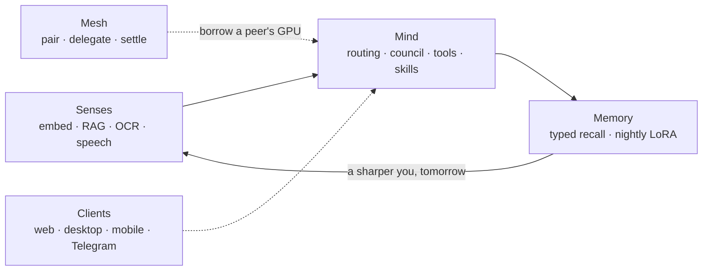

import { LessonVideo } from "/snippets/lesson-video.jsx";

Leash is a private, offline personal AI that lives across devices you own. Every inference, embedding, retrieval, vision, speech, delegation, and fine-tuning path runs through QVAC on local hardware. There is no setting that swaps in a cloud model.

Leash won **first place overall** and the **Build in Public** prize at QVAC Hackathon I, "Unleash Edge AI" (July 2026).

<LessonVideo playlistId="PLeERy8YL4mpQwT3OwpzOqjp23FlrLQ_1Y" title="Leash demo playlist" />

<CardGroup cols={3}>
  <Card title="Source code" icon="github" href="https://github.com/danielAsaboro/leash">
    Apache-2.0, every layer real.
  </Card>
  <Card title="Leash docs" icon="book" href="https://docs.useleash.xyz/">
    Install, platforms, and the proofs.
  </Card>
  <Card title="Website" icon="globe" href="https://www.useleash.xyz/">
    The product surface.
  </Card>
</CardGroup>

## Five layers, one organism

Leash is the product you talk to. Mycelium is the runtime underneath it.

| Layer | What it does |
|---|---|
| Mesh | Encrypted peer-to-peer pairing, delegated compute, metered settlement, a shared context graph |
| Senses | Embeddings, RAG, OCR, speech-to-text, screen and photo sensing |
| Mind | Routing between local and peer models, a proposer and critic council, cited answers, tools, skills |
| Memory | Typed memory and recall, plus a nightly LoRA fine-tune on QVAC Fabric |
| Clients | Web, Electron desktop, iOS and Android, a Telegram bridge |

## What it measured

These numbers come from the committed evidence bundle in the repository, on the hackathon hardware.

| Measurement | Result |
|---|---|
| Llama 3.2 1B, warm time to first token | 56 ms at 70.6 tokens/s |
| RAG retrieval | 23 ms, top score 0.768 |
| Two-Mac delegated completion | 317 ms to first token at 100.7 tokens/s |

## Lessons you can take without building Leash

1. **Give the model a bounded job.** A local model does not need to beat frontier models. It needs a clear responsibility, private context, deterministic guardrails, and review.
2. **Make privacy a routing rule, not a promise.** Leash's router never sends a private prompt to a public peer, and nothing can override that.
3. **Ship receipts.** Every claim in the README links to a log, a smoke script, or a JSON summary. If you say it runs offline, prove it.
4. **Contribute upstream.** Building Leash surfaced a gap in the SDK, which became a contribution to QVAC itself: [tetherto/qvac#2459](https://github.com/tetherto/qvac/pull/2459), `image_url` content in chat completions.

<Card title="Build these ideas yourself" icon="arrow-right" href="/apps">
  Every Bring AI Home project applies the same principles to one everyday app.
</Card>
