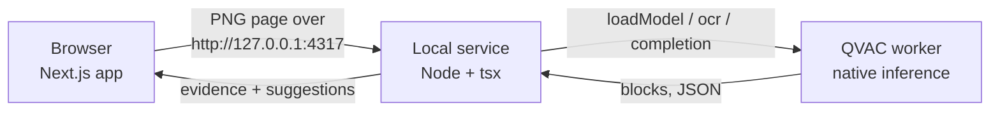

The documents people redact are the ones they least want to upload: passports, bank statements, contracts. Running the models on the same machine as the document removes the upload entirely. It also moves the cost of inference from someone else's data center onto your disk, memory and patience.

## What runs where

Redact is three processes on one computer.

The **browser** opens the file, rasterizes each page to a PNG, and shows the review workspace. It never sees model weights.

The **local service** (`npm run qvac:service`) is a small Node HTTP server bound to `127.0.0.1`. It owns the QVAC SDK, loads the two models once, and turns one page into OCR blocks and suggestions.

The **QVAC worker** is a separate process the SDK starts. It runs the native engines: an OCR pipeline for reading and a llama.cpp-based engine for the language model. The SDK talks to it over local IPC. See [How it works](https://docs.qvac.tether.io/sdk/how-it-works/) for QVAC's own description.

## What "local" buys

No document byte leaves the machine during analysis. You can check this rather than trust it: the macOS offline run denies the process any non-localhost network and still produces suggestions ([Lesson 10](/docs/redact/tutorials/10-offline)).

Local also means no per-page cost, no account, and no service that can change its model or retention policy under you. The model version is whatever your lockfile and cache say.

## What it costs

On an Apple Silicon Mac with 36 GB of memory:

- `npm ci` installs about 2.8 GB of dependencies with `@qvac/sdk` 0.22.
- The OCR and decision models add about 550 MB on first use.
- OCR takes 20 to 30 seconds per page; the language model adds 2 to 9 seconds.
- Pages are analysed one at a time, so a 25-page PDF can take more than ten minutes.

A hosted vision API would usually be faster and more accurate. The trade is deliberate: for this kind of document, the upload is the risk we are removing, so a slower, smaller, local model is the right tool. Where accuracy falls short, the human review step covers it ([About Redact's trust boundary](/docs/redact/concepts/trust-boundary)).

## Lifecycle matters more locally

A hosted API hides model loading. Locally it is your problem. The service loads each model on first use and keeps it in memory; loading is where the first-run download happens. On shutdown it calls `unloadModel` and `close` so the worker exits cleanly instead of leaving native memory behind. QVAC's [Lifecycle](https://docs.qvac.tether.io/sdk/runtime/lifecycle/) page describes these calls.

The same thinking explains why the service, not the browser, holds the SDK. The native engines need a Node process with file system access, and keeping them behind one long-lived process means each model loads once instead of once per page.

## Related

- [About the local service](/docs/redact/concepts/local-service)
- [About model downloads, caching and offline use](/docs/redact/concepts/models-and-offline)
- [Requirements](/docs/redact/reference/requirements)
- [System requirements](https://docs.qvac.tether.io/sdk/system-requirements/) (QVAC)
