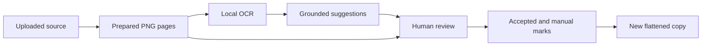

You have a screenshot or PDF to share. It contains a name, address, phone number, or account identifier. Redact helps you review those details, cover the ones you choose, and create a separate flattened copy.

We will start with a working manual Redact application and add local intelligence in small, verifiable steps. By the end, the app will read its prepared page images with QVAC, propose sensitive fields, ask you to accept or reject each proposal, and keep manual editing available when inference fails.

<CardGroup cols={2}>
  <Card title="Begin with the starter" icon="play" href="/redact/01-starter">
    Run the app and save your first manually redacted copy.
  </Card>
  <Card title="Download the starter" icon="download" href="/downloads/redact/redact-starter.zip">
    A pinned source package with its lockfile and fictional test documents.
  </Card>
</CardGroup>

## The starting point

The starter is the completed **non-AI Redact product**, matching the starting point of the existing video series. It already has upload, configuration, rasterization, manual drawing and editing, preview, and flattened export. This course teaches how to build the local-AI Redact workflow from that template. It does not teach creating its interface from an empty Next.js project.

A proposal is never automatically an output mask. QVAC provides evidence and candidates; only a human decision creates an accepted mark.

## What you need

- Familiarity with React, TypeScript, npm, and editing source files.
- Git and Node.js **22.17 or newer**.
- A development machine able to run the pinned QVAC native dependencies and models. Check the [QVAC documentation](https://docs.qvac.tether.io/) for support on your hardware.
- Internet access for initial dependency and model downloads. Cached inference and network denial are separate later exercises.
- macOS with `sandbox-exec` for Chapter 10's supplied process policy. Earlier chapters do not use that policy.
- Space and memory for the native runtime and local models. This course does not promise a universal resource requirement or inference time.

Use the supplied fictional documents throughout. They let us deliberately accept, reject, and miss fields without putting someone's real records at risk.

## The course path

| Chapter | You build | You observe |
| --- | --- | --- |
| [1. Starter](/redact/01-starter) | A baseline you can run and inspect | A separate manually redacted PNG and PDF |
| [2. First OCR](/redact/02-first-ocr) | One standalone local model operation | Source-bound text and geometry |
| [3. Local service](/redact/03-local-service) | A typed and runtime-validated bridge | Honest readiness and unavailability |
| [4. Connect OCR](/redact/04-connect-ocr) | Uploaded page bytes through real inference | Evidence plus manual fallback |
| [5. Coordinates](/redact/05-coordinate-mapping) | One geometry conversion boundary | Outlines aligned to the analyzed pixels |
| [6. Suggestions](/redact/06-sensitive-suggestions) | Grounded structured reasoning | Reviewable sensitive-field proposals |
| [7. Review](/redact/07-human-review) | Accept, Reject, audit, and final guards | Human decisions becoming ordinary marks |
| [8. Failure recovery](/redact/08-failure-recovery) | Timeout, cancellation, retry, and slot ownership | A usable document even when analysis fails |
| [9. Evaluation](/redact/09-evaluation) | Four labelled cases and quality gates | Matches, misses, geometry, and performance |
| [10. Offline proof](/redact/10-offline-proof) | Cached process-constrained inference and browser checks | A reviewed download with explicit proof limits |

## How to use the implementation material

Every chapter states the source checkpoint, explains the code in implementation order, supplies complete key files, and provides a patch containing all of its changes, including UI wiring, tests, and lockfile updates.

Read and apply the patch, then trace the implementation and run the exercises. If you prefer writing the changes yourself, use the complete files and patch as your reference instead. Do not apply the same patch on top of your own equivalent edits.

The starter ZIP needs no access to a private Git repository. Chapter 1 initializes local history. Follow chapters in order and commit each successful checkpoint. The [download manifest](/downloads/redact/manifest.json) records full source commit identifiers and SHA-256 hashes for the downloadable packages and patches.

The [completed course source](/downloads/redact/redact-completed.zip) is a separate reference download. Extract it into a different directory if you need to compare your work; do not overwrite your exercise directory.

## Versions are part of the lesson

These chapters follow the ten historical commits on `course/redact-qvac`, from `0eecfb4` to `a22cd5f`, using **`@qvac/sdk` 0.17.1**. The later release checkout uses SDK 0.20.0 and has additional changes. Those release changes are outside this pinned course.

Use each checkpoint's lockfile. If you change a runtime version, treat that as a separate migration and rerun its real inference and product checks. A current API example is not automatically compatible with the historical implementation.

## What counts as success

A deterministic test can verify a contract without invoking a model. A live OCR receipt proves that inference ran on that input. A browser exercise proves an interaction path. Inspecting the exported file checks what another person will actually receive.

We use each level where it is needed. A green docs build, a skipped browser test, a warmed cache, or a covered preview cannot substitute for the others.

Historical video measurements describe earlier runs. They are context, not benchmark targets or claims that this written course was rerun with live QVAC today. Record your own model-backed receipts.

Begin with [Chapter 1: Run the Redact starter](/redact/01-starter).
