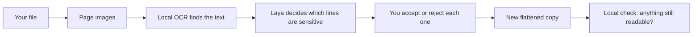

Imagine you run the front desk at a small clinic. 

A patient's insurer wants a screenshot of a message thread to process a claim. The thread has the patient's name, phone number, home address and policy number in it, and you need to send everything except those. It's late, there are twelve of these to do, and there's an AI chat window open in the next tab that would find every name in a second. You'd just have to paste the screenshot in.

## This isn't isolated to Clinics alone

The same moment happens wherever people share documents that contain other people's details: a paralegal sending a contract excerpt to opposing counsel, a support agent attaching a chat log to a bug report, an HR officer forwarding a payslip, an engineer pasting a log file into a ticket, a journalist publishing a leaked memo without exposing its sources. 

The document has to go out; parts of it must not.

## What the evidence says

People already reach for cloud AI in exactly this moment. In a [January 2025 survey of 1,000 US employees by TELUS Digital](https://www.telusdigital.com/about/newsroom/telus-digital-survey-reveals-enterprise-employees-use-of-shadow-ai), 57% of those using public AI assistants at work admitted entering sensitive information into them. The most common kind was personal data such as names, addresses, emails and phone numbers (31%), followed by customer information (21%).

The cost of getting it wrong keeps rising. IBM's [Cost of a Data Breach Report 2026](https://www.ibm.com/reports/data-breach) puts the global average cost of a breach at $4.99 million, a record high and 12% more than the year before.

Professional rules haven't relaxed for AI either. When the American Bar Association issued [its first guidance on lawyers' use of AI](https://www.americanbar.org/news/abanews/aba-news-archives/2024/07/aba-issues-guidance-lawyers-use-ai-tools/), Formal Opinion 512 (July 2024), it reminded lawyers that under Model Rule 1.6 they must keep all information relating to a client's representation confidential unless the client gives informed consent, and that this applies when they use generative AI.

And covering text by hand has its own famous failure. In January 2019, lawyers for Paul Manafort filed a court document whose black bars sat on top of text that was still there: [a Guardian reporter copied and pasted the "redacted" passages](https://www.cjr.org/analysis/manafort-mueller-redacted-document-ukraine.php) into a new document and read them.

## The options

- **Don't use AI.** Read every line and cover it by hand. It works, but it's slow, and attention fades by the twelfth document. Misses are silent.

- **Use a cloud AI tool.** It's fast and good at spotting names. But the document, with everything you meant to hide, is sent to someone else's servers before anything is hidden. What happens to it next depends on that provider's retention and training terms, your plan, and your settings. For a clinic or a law firm, that's often the end of the discussion.

- **Use a PDF editor's box tool.** Unless it truly removes the content, the text under the box is still in the file, as the Manafort filing showed.

- **Use local AI.** Run the models on your own computer, so the document never leaves it. Until recently the models small enough to do this were too weak to be useful. They are now good enough for this job, with limits we measure honestly: on Redact's labelled test pages, local suggestions score between 0.83 and 0.92 F1, and the app is built on the assumption that a person checks every one.

## What we'll build

Redact is a small web app that does the fourth option with [QVAC](https://docs.qvac.tether.io/), Tether's SDK for running AI models locally. Every model runs on your machine; the only network traffic is downloading the models once.

1. You upload a PNG, JPEG or PDF. The original is never changed.
2. Each page becomes an image, and local OCR reads its text and where each line sits.
3. Laya, a small decision model, answers one yes/no question per line and field: does this contain a name, an email, an account number?
4. You accept or reject every suggestion, and can draw your own marks.
5. Redact paints the marks into a new image (or image-only PDF), so there is no text left underneath.
6. It reads that copy once more and tells you if anything private is still readable.

At the end you have a working app, its source on [`course/redact-qvac`](https://github.com/danielAsaboro/bring-ai-home/tree/course/redact-qvac/redact), and an evaluation that measures its suggestions on labelled pages.

**What it costs:** about 4 GB of disk (2.8 GB of dependencies, about 550 MB of models), an internet connection for the first run, and time: OCR takes 20–30 seconds per page on an Apple Silicon Mac, and the copy check about 25 seconds more. It doesn't claim legal-grade redaction or catch everything; [About what Redact does not protect](/docs/redact/concepts/threat-model) lists the limits.

**Who it's for:** developers who know React and TypeScript and want to learn local AI by building something real. You don't need any machine-learning background.

<CardGroup cols={2}>
  <Card title="Use Redact" icon="play" href="/docs/redact/tutorials/00-use-redact">
    Run the finished app on a sample document.
  </Card>
  <Card title="Build Redact" icon="hammer" href="/docs/redact/tutorials/01-starter">
    Eleven lessons, from a manual app to local OCR, suggestions, review and a decision model.
  </Card>
</CardGroup>

The **How-to guides**, **Reference** and **Concepts** tabs cover specific tasks, exact details, and the reasoning behind the design. Everything here uses `@qvac/sdk` 0.22.0; full requirements are in [Requirements](/docs/redact/reference/requirements).
