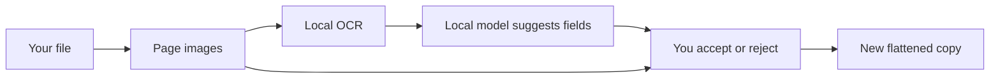

You have a screenshot or PDF to share, and it contains a name, an address, a phone number, or an account number. Redact reads the page on your own machine with [QVAC](https://docs.qvac.tether.io/), suggests what to cover, and lets you accept or reject every suggestion before it saves a separate, flattened copy. Nothing is uploaded, and the original file is never changed.

<CardGroup cols={2}>
  <Card title="Use Redact" icon="play" href="/docs/redact/tutorials/00-use-redact">
    Run the finished app and redact your first document with local AI.
  </Card>
  <Card title="Build Redact" icon="hammer" href="/docs/redact/tutorials/01-starter">
    Ten lessons, from a manual app to local OCR, suggestions, review and an offline proof.
  </Card>
</CardGroup>

## What's here

| Section | Use it when |
|---|---|
| **Tutorials** | You're new and want to learn by doing, one lesson at a time. |
| **How-to guides** | You know the app and want to get a specific job done. |
| **Reference** | You need an exact command, setting, limit or error code. |
| **Concepts** | You want to understand why Redact works the way it does. |

## Before you start

- Node.js 22.17 or newer, Git, and about 4 GB of free disk.
- An internet connection for the first run, which downloads about 480 MB of models. After that, Redact runs offline.
- macOS (Apple Silicon), Linux or Windows supported by QVAC. The lessons were tested on macOS; the offline proof in lesson 10 needs macOS.

Full details: [Requirements](/docs/redact/reference/requirements).

## Versions

Everything here uses **`@qvac/sdk` 0.22.0** on branch [`course/redact-qvac`](https://github.com/danielAsaboro/bring-ai-home/tree/course/redact-qvac/redact). Each lesson is one commit on that branch. The matching QVAC documentation is the [current SDK docs](https://docs.qvac.tether.io/sdk/).
