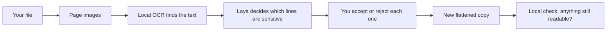

import { LessonVideo } from "/snippets/lesson-video.jsx";

<LessonVideo title="Redact · 00. Use Redact" />

Yes, to all four questions.
In this course we build **Redact**, a small web app that finds the private details in a screenshot or PDF, lets you decide what to cover, and saves a clean copy you can share.
Every AI model runs on your own computer, through [QVAC](https://docs.qvac.tether.io/), Tether's SDK for local AI.
The document never leaves the machine; the only download is the models, once.

## How Redact works



1. You upload a PNG, JPEG or PDF.
   The original is never changed.
2. Each page becomes an image, and local OCR reads its text and where each line sits.
3. Laya, a small decision model, answers one yes/no question per line and field: does this contain a name, an email, an account number?
4. You accept or reject every suggestion, and can draw your own marks.
5. Redact paints the marks into a new image (or image-only PDF), so no text is left underneath.
6. It reads that copy once more and tells you if anything private is still readable.

Nothing becomes a black box until you say so.
The model suggests; you decide.

## Why QVAC

QVAC runs both kinds of model Redact needs, a text reader and a decision model, through one JavaScript API on your machine.
There is no server to host, no API key, and no request that leaves the computer.
It runs on macOS, Linux and Windows, using the GPU where there is one.

## What you'll run

Redact is two processes on your machine:

| Process | Command | What it does |
|---|---|---|
| The app | `npm run dev` | A Next.js page at `localhost:3101`. Turns your file into page images, shows suggestions, paints the marks, saves the copy. |
| The local AI service | `npm run qvac:service` | Listens on `127.0.0.1:4317` only. Uses the [QVAC SDK](https://docs.qvac.tether.io/sdk/js-ts-sdk/) to run two models on your machine. |

The models download once, into `redact/.qvac/models`:

| Model | Size | Job |
|---|---|---|
| `OCR_LATIN` | 98 MB | Finds each line of text and where it sits on the page |
| `LAYA_421M_Q8_0` | 450 MB | Answers yes/no questions about each line: is this a name, an email, an account number? |

## What it costs

- **Disk:** about 4 GB: 2.8 GB of dependencies and about 550 MB of models.
- **Network:** only for installing and the first run, which downloads the models.
- **Time:** on an Apple Silicon Mac, OCR takes 20–30 seconds per page, Laya's decisions under a second, and the final check of the copy about 25 seconds.
- **Limits:** it doesn't claim legal-grade redaction or catch everything.
  [About what Redact does not protect](/docs/redact/concepts/threat-model) lists what it can't do.

This course is for developers who know React and TypeScript and want to learn local AI by building something real.
You don't need any machine-learning background.

## The base template

You won't start from an empty folder.
We've prepared a base template: the complete Redact interface with **no AI in it**.
It already uploads PNG, JPEG and PDF files, turns pages into images, lets you draw, move and resize marks by hand, previews the safe copy, and saves a flattened PNG or PDF.

The **Build it** lessons start from that template and add the AI one step at a time:

| Lessons | What we add |
|---|---|
| [01](/docs/redact/tutorials/01-starter) | Run the template and redact a document by hand |
| [02–05](/docs/redact/tutorials/02-first-ocr) | Local OCR: read a page, run a local service, line the boxes up with the page |
| [06–07](/docs/redact/tutorials/06-suggestions) | Suggestions from a local model, and a review step where you accept or reject each one |
| [08–10](/docs/redact/tutorials/08-failure-recovery) | Recovery when analysis fails, a measured evaluation, and proof it works offline |
| [11](/docs/redact/tutorials/11-laya-decisions) | Swap the generator for Laya, and check the copy before it's shared |

You can [download the template](/docs/downloads/redact/redact-starter.zip) now, or get it in lesson 01.

## Try the finished app first

In the rest of this lesson we will run the finished app, give it a screenshot of a fictional chat, and turn its suggestions into a safe copy we could share.

You need Node.js 22.17 or newer, Git, about 4 GB of free disk, and an internet connection for the first run.

## 1. Get the app

```bash
git clone --branch course/redact-qvac https://github.com/danielAsaboro/bring-ai-home redact-app
cd redact-app/redact
npm ci
```

`npm ci` takes a few minutes and ends with an `added … packages` line.
The QVAC SDK and its native engines are most of the 2.8 GB it installs.

## 2. Start the local AI service

In this terminal, run:

```bash
npm run qvac:service
```

You should see:

```text
Redact QVAC service listening on http://127.0.0.1:4317
```

This is the process that runs OCR and the decision model.
It only listens on `127.0.0.1`, so nothing outside your machine can reach it.
Leave it running.

## 3. Start the app

Open a second terminal in the same `redact` folder and run:

```bash
npm run dev -- --port 3101
```

When it prints `Ready`, open [http://localhost:3101](http://localhost:3101). You'll see **What do you need to share safely?** and a drop zone.

## 4. Choose the document and a privacy level

Select **Choose a file** and pick `public/test-files/redact/chat-private.png` from the `redact` folder.
It's a made-up chat between Maya Chen and a colleague; none of it is real.

Under **Privacy level**, select **Private**.
In **Additional direction**, type:

```text
Redact direct identifiers, account numbers, and reference codes.
```


Select **Prepare for review**.

## 5. Wait for the first analysis

The screen shows **Preparing locally** while the page is read.
The first time, QVAC downloads the OCR model and Laya, the decision model that suggests what to cover, about 550 MB in all, into `redact/.qvac/models`, so expect a few minutes.
Watch the service terminal: it stays quiet unless something fails.

Later runs skip the download.
Reading one page then takes about 20–30 seconds.

## 6. Review the suggestions

The review screen opens with the original on the left and a **Safe-share preview** in the middle.


Notice three things:

- Every outlined box on the original is text that OCR found.
  The right panel says **12 text regions found locally**.
- Under **7 suggested redactions** are the name, email, address, phone number, account number and reference, plus `keep the amount confidential.` labelled **OTHER**, which matched your direction.
  Each has a label, a score and the text it would cover.
- **Done** is disabled.
  The banner says **Review 7 remaining suggestions before creating a safe copy.**
  Nothing is covered until you decide.

Let's make one decision differently from the rest.
On the **EMAIL** card, select **Reject**.
Then select **Accept** on the other six cards.

The preview updates as you go: accepted fields turn into black boxes, and the email stays readable.
The **Recent activity** list records each decision.

## 7. Save the copy

Select **Done**.
The screen changes to **Your safe copy is ready**, and Redact reads the copy it just made, the same way it read the original.
After about 25 seconds it lists what is still readable:


That's the email we rejected.
The check is a reminder, not a block: you decided to keep the email, so **Save copy** stays enabled.

Select **Save copy**.
Your browser downloads `chat-private.redacted.png`.

## 8. Check what you'll share

Open the downloaded file outside the browser.


The name, address, phone number, account number, reference and the "amount" line are solid black.
The email is still there, because we rejected that suggestion.
The covered text is gone from the file itself: the copy is a new image, not the original with boxes drawn on top.

Now open `public/test-files/redact/chat-private.png` again.
It's unchanged.

## What we did

We ran a privacy tool whose OCR and decision model both ran on our own machine, let it propose what to cover, overruled it once, and produced a flattened copy that contains only what we approved.

To stop, press `Ctrl+C` in both terminals.
The models stay in `redact/.qvac/models` for next time.

## Next

- Build this app yourself, starting from a version with no AI: [01.
  Run the manual starter](/docs/redact/tutorials/01-starter).
- Why a suggestion never covers anything on its own: [About Redact's trust boundary](/docs/redact/concepts/trust-boundary).
