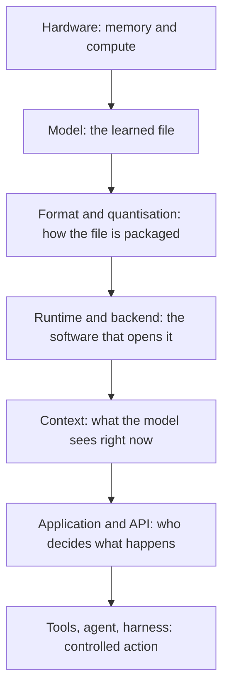

import { LessonVideo } from "/snippets/lesson-video.jsx";

<LessonVideo title="AI is not one box" />

Most diagrams show AI as one box: your app sends something in, intelligence happens, an answer comes out.
For cloud AI that picture works, because the provider hides every layer behind a model name in a dropdown.

Local AI moves the intelligence onto hardware you control, and the hidden layers come with it.
That is where the confusion starts: parameters, weights, GGUF, quantisation, context window, KV cache, runtime, backend, agent, harness.
You do not need to master them at once.
You need to know **which layer each word describes**.

## Hardware is the floor

Think of a model as a photograph saved on your computer.
On disk it is idle.
To use it, software loads it into working memory and uses compute to process it.

Two things matter: **memory** decides what fits, **compute and memory bandwidth** decide how fast it runs.
The model shares memory with your operating system, your apps, its context, and its cache, so file size alone never tells you the full requirement.
Apple Silicon's unified memory lets the CPU and GPU share one pool.
A safe default for this course is recent Apple Silicon with 32 GB.

## The model is the file

The model holds learned information for a kind of task.
Inside it are **parameters**, including numerical **weights** set during training.
"Four billion parameters" describes scale, not quality.
A larger model may handle more complexity but asks more of the machine, and a smaller task-specific model can be the better choice.

The task chooses the model, not the other way around.

## Format and quantisation describe the copy

A photo can be a PNG, JPEG, or RAW: same image, different packaging, different software that can open it.
Model **formats** work the same way.
GGUF is used by GGML-based engines such as llama.cpp; other ecosystems use safetensors or MLX repositories.
The file and the software have to agree.

**Quantisation** is like resolution.
Q8 keeps more numerical detail and uses more memory; Q4 is smaller and easier to fit, with more risk of quality loss.
Technically it changes the precision of existing weights, but the beginner rule holds: higher number, clearer and larger.

## The runtime opens the file

A **runtime** (inference engine) loads the model, manages memory, and turns an input into an output.
Under it, a **backend** reaches the hardware: Metal, CUDA, Vulkan, or CPU.
QVAC Fabric, the engine under the QVAC SDK, is one of these.

The lifecycle matters in every lesson that follows:

| State | What it means |
|---|---|
| Downloaded | The file is on disk |
| Loaded | It is prepared in working memory |
| Inferring | It is processing an input right now |
| Unloaded | Memory is released; the file stays on disk |

Downloaded is not loaded.
Loaded is not inferring.

## Variants decide what it can do

Not every model is an LLM: there are vision, speech, embedding, OCR, and classifier models.
Within one family, a **base** model continues text while an **instruct** model follows requests.
The **tokenizer** and **chat template** must match the variant.
The right question is never "is this a good model?"
It is "is this the right model for this job and this machine?"

## Context is the working state

The weights stay fixed.
The **context window** is what the model can see for this request: instructions, history, retrieved documents, tool descriptions, and the answer so far, measured in tokens.
A model's maximum context is a ceiling, not a promise your machine can use it.
Longer context grows the **KV cache**, which stores earlier calculations and costs memory.

Context is not long-term memory.
Anything an app "remembers" is stored outside the model and brought back on purpose.

## A model is not an agent

A model produces output.
It has no authority to change a file, call an API, or update state.
Your application decides what goes in, when inference runs, and what becomes permanent.

A **tool** is a capability your software exposes.
A model can propose a tool call, but your code validates, checks permission, and executes it.
An **agent** is a model running in a loop toward a goal, and the **harness** is everything around it: the loop, tools, permissions, state, guardrails, and stop conditions.
Same model, different harness, different behaviour.
Many features need only one bounded inference.

## What "local" actually means

| Claim | What it promises |
|---|---|
| Local execution | Inference happens on the user's machine |
| Offline-capable | The workflow continues without a network once dependencies are present |
| Local-first | The user's environment is the default; a remote path may exist |
| Network-isolated | A boundary you can enforce and test |

"Runs locally" is an architectural claim.
Every project on this site ends by producing a receipt for it.

<Card title="Next: your first QVAC app" icon="arrow-right" href="/docs/start-here/first-qvac-app">
  Put the stack to work in fifteen minutes.
</Card>
